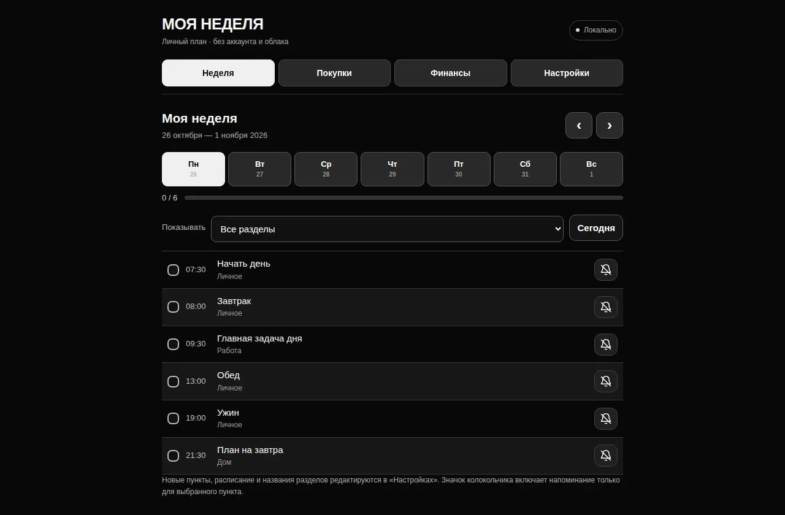
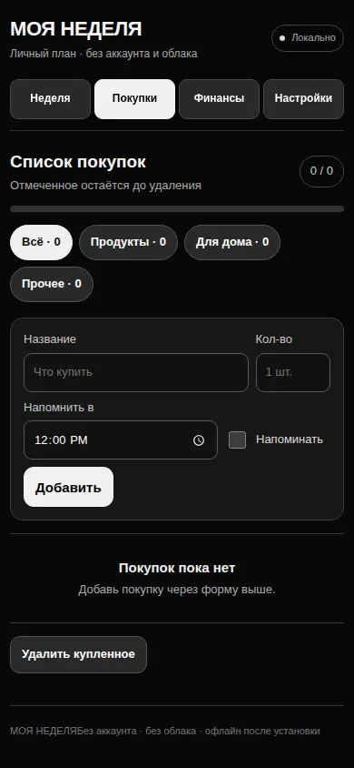

# МОЯ НЕДЕЛЯ — локальный планировщик

Локальный PWA-планировщик: неделя, покупки, финансы и резервные JSON-копии. HTML / CSS / JavaScript; данные хранятся в браузере.

**Быстрый запуск:** `python3 -m http.server 8000` → http://localhost:8000/.

**Попробовать за минуту:** добавьте дело в настройках, отметьте его на неделе и скачайте JSON-копию. Для уведомлений при закрытом браузере используйте экспорт `.ics`; обычные JavaScript-таймеры не гарантируют фоновые сигналы.

В отличие от [The Butler](https://github.com/Vremennobeznika/The-butler), этот проект сосредоточен на расписании, покупках и финансах. The Butler дополняет их панелью «Сегодня», бытовыми шаблонами и помощником для Mac.

## Скриншоты






Самостоятельное приложение без аккаунта, платных API, рекламы, аналитики и серверного хранилища. Код можно разместить на GitHub Pages (сервер отдаёт **только статические файлы**); расписание, отметки, покупки и финансы хранятся **в localStorage браузера на устройстве**. Не выполняет сетевых запросов к сторонним сервисам.

## Возможности

- Неделя: дни, расписание, отметки выполнения и прогресс. Переключение недель и фильтр по разделам.
- **Отдельная страница «Настройки»**: названия, порядок, видимость и удаление разделов; добавление, редактирование, дублирование, поиск и удаление пунктов; время, дни недели или разовую дату, примечания.
- **Напоминание включается/выключается у каждого пункта отдельно** — на основной странице и в настройках. Тихие часы; необязательный звук; кнопка «Через 10 минут» и «Готово».
- Покупки по собственным категориям, количество, чекбоксы и независимые напоминания для каждой покупки с отдельным временем.
- Финансы: доходы, расходы, категории, помесячные результаты, журнал операций, знак валюты и CSV-экспорт.
- Экспорт/импорт полных JSON-копий. Перенос данных между устройствами **только вручную**.
- Экспорт календарных уведомлений `.ics` на следующие 30 дней для активных пунктов с включёнными напоминаниями и один раз для незавершённых покупок с напоминанием.
- Импорт прежнего календаря: вкладка «Настройки» → «Импорт прежнего календаря (.html)»; затем при необходимости «Импорт прежних отметок (.json)». Так личные записи можно перенести из старого календаря **локально, без публикации личных данных в GitHub**.
- PWA: установка на главный экран и offline-кеш после первой загрузки по HTTPS/localhost.

## Запуск

Простейший тест: `python3 -m http.server 8000` в каталоге проекта и открыть `http://localhost:8000/`. Для работы PWA на телефоне нужен HTTPS: статический GitHub Pages подходит, поскольку данные остаются в браузере.

## Создание **отдельного** репозитория GitHub

Создать новый пустой репозиторий `local-life-planner`, не заменять и не переименовывать существующий `enjigirling`:

```bash
cd local-life-planner
git init
git add .
git commit -m "Add standalone local life planner"
git branch -M main
gh repo create Vremennobeznika/local-life-planner --public --source=. --remote=origin --push
```

Команда `gh` требует установленного GitHub CLI и входа в аккаунт. Можно загрузить содержимое папки в новый репозиторий через GitHub вручную. Чтобы включить сайт: Settings → Pages → Deploy from a branch → `main` / `/ (root)`.

## Уведомления: реальные ограничения браузеров

В открытой вкладке приложение проверяет время примерно раз в 15 секунд и показывает крупное напоминание, а при разрешении — системное уведомление. При возвращении в приложение уведомления могут догнать расписание за последний час. При нажатии по уведомлению PWA **пытается открыть или активировать** соответствующую вкладку через service worker. **Автоматический принудительный перевод другой вкладки/телефона на передний план браузер запрещает.** Фоновое выполнение веб-таймеров ненадёжно, а после закрытия браузера локальные JS-таймеры не работают.

В iOS системный **Web Push** для установленных на домашний экран веб-приложений требует push-сервера. Здесь сервера и облака нет, поэтому фоновые Web Push не реализованы. Чтобы получать уведомления при закрытом браузере, экспортируйте `.ics` и добавьте его в календарь устройства (импортированные события — отдельная копия). Не импортируйте файл повторно, не удалив старые события, иначе возможны дубли.

## Хранение и безопасность

`localStorage` не является надёжной резервной копией. Не используйте режим инкогнито для постоянного хранения. Периодически скачивайте JSON-архив. Записи разных устройств не синхронизируются и никак не отправляются на GitHub. Хранящиеся в браузере данные **не зашифрованы**, поэтому не рекомендуется записывать секреты. Импорт ограничен размером файла и проходит проверку структуры; HTML прежнего календаря разбирается как текст, без исполнения кода.

## Проверка

- `node --test tests/model.test.cjs` — 19 тестов: контроль нормализации, дат, фильтров, уведомлений, расчётов, календаря и миграции.
- `python tests/ui_smoke.py .` — автоматизированное взаимодействие с Chromium на ширинах 320, 390 и 1280 px (необходимо установить Python-пакеты `playwright`, `beautifulsoup4` и Chromium).
- Тесты в контейнере не заменяют проверки на реальном Safari/macOS/iOS; push-уведомления, установку PWA и импорт календаря следует дополнительно проверить на целевых устройствах.

## Android: установка и ограничения

- Открой опубликованный сайт по HTTPS в Chrome для Android. Меню Chrome → «Установить приложение» или «Добавить на главный экран».
- На экранах от 280 CSS-px работают четыре вкладки, сенсорные кнопки и независимые настройки пунктов.
- Данные остаются в этом браузере без сервера. Очищение данных сайта удаляет их: экспортируй JSON через «Настройки» и храни копию вне браузера.
- Локальные напоминания в открытой вкладке доступны. При полностью закрытом приложении Android не обязан исполнять JavaScript и не гарантирует доставку напоминания. Для надёжных внешних сигналов экспортируй .ics в календарь Android, заново импортируя его после изменения расписания.
- Разрешение на системные уведомления выдаётся Chrome и Android отдельно. Даже при разрешении не гарантируется принудительный переход приложения на передний план.
- Публикация исходников в GitHub не включает GitHub Pages автоматически: Settings → Pages → Deploy from a branch → main / (root).
- CI проверяет эмуляцию мобильного Chromium, касания, ввод, данные, offline/PWA через localhost; реальные физические телефоны не охвачены.
